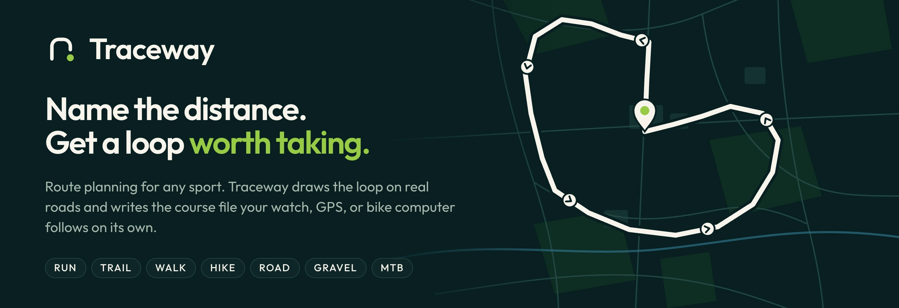
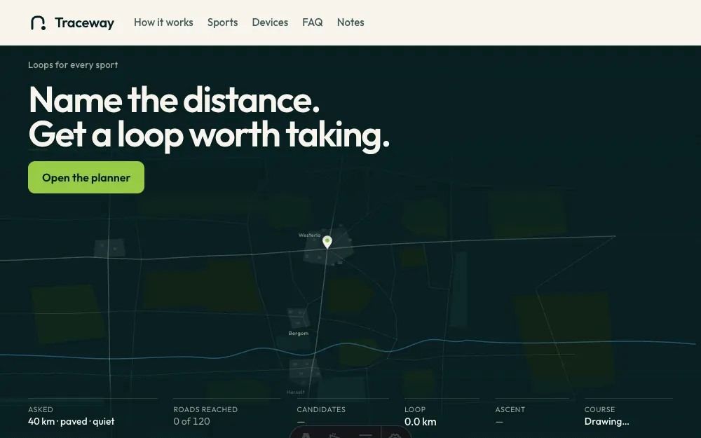
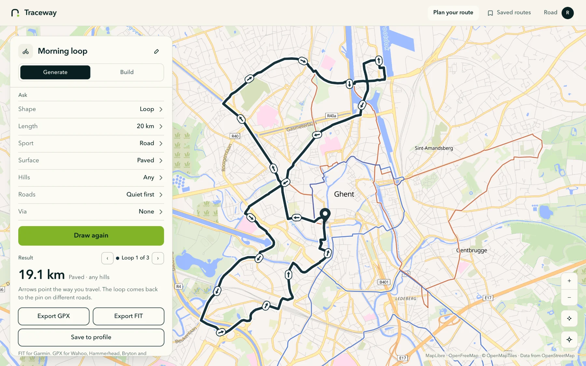

<p align="center">
  <a href="https://traceway.online">
    
  </a>
</p>

<p align="center">
  <a href="https://github.com/NxT-Solutions/Traceway/actions/workflows/ci.yml"></a>
  <a href="https://github.com/NxT-Solutions/Traceway/releases/latest"></a>
  <a href="LICENSE"></a>
  <a href="https://traceway.online"></a>
</p>

<p align="center">
  <a href="https://traceway.online"><b>Open the planner</b></a>
  &nbsp;·&nbsp;
  <a href="https://traceway.online/#how">How it works</a>
  &nbsp;·&nbsp;
  <a href="https://traceway.online/#devices">Devices</a>
  &nbsp;·&nbsp;
  <a href="#run-it-locally">Run it locally</a>
  &nbsp;·&nbsp;
  <a href="CONTRIBUTING.md">Contribute</a>
</p>

<br>

https://github.com/user-attachments/assets/add4d827-82a7-4a9a-973d-9ef6819503d2

<p align="center"><sub>Press play for the 24-second film. Turn the sound on.</sub></p>

Traceway plans a loop for any sport and writes the course file your watch, GPS, or bike computer follows on its own. Drop a pin, name a distance, pick a sport. Traceway reads the roads and paths around the pin, draws the loops that come back without doubling over themselves, and keeps the best one. Then you take the file and leave the phone at home.

No feed, no followers, no leaderboard. Just the map and the route.

## What it does

<table>
  <tr>
    <td width="33%" valign="top">
      <h3>Generate</h3>
      Set a start, a length, a sport, a surface, the hills, and how quiet the roads should be. Traceway draws three loops, scores them, and shows the one closest to your ask. Add a via to bend the loop through a place.
    </td>
    <td width="33%" valign="top">
      <h3>Build</h3>
      Tap the map to draw your own route. Each tap snaps to the nearest real road or path, and the route closes back to the start.
    </td>
    <td width="33%" valign="top">
      <h3>Export</h3>
      Download a FIT course for Garmin or a GPX file for anything else. Save a route to your profile, or share it with a signed link.
    </td>
  </tr>
</table>

## How a loop is drawn

<p align="center">
  
</p>

Traceway reads the roads and paths within reach of the pin and asks the routing engine for the ways back. Every way back gets a score, and each sport scores the map its own way: road, run, and walk mark busy roads down hard, while gravel, mountain bike, and trail care more about surface and climb. The best three come out ahead, with arrows for the way you go. Add a via and the loop bends through it, closed, on roads, and never doubling back along the same stretch.

## Every sport, one planner

Foot and bike are equal in Traceway. Foot sports route the way a walker or runner moves, and bikes route by bike type: road, gravel, or mountain. The surface you pick, paved, mixed, or dirt, decides how much tarmac the loop takes.

- **On foot:** run, trail run, walk, hike.
- **On a bike:** road, gravel, mountain bike.

## On your device

The device already knows the map. Traceway gives it the course.

- **Garmin:** a FIT course. Import it in Garmin Connect under Training, Courses, or copy it to `Garmin/NewFiles` over USB.
- **COROS, Suunto, Wahoo, Hammerhead, Bryton:** the same GPX file.
- A Garmin shows the first 15 characters of a course name, so Traceway keeps a short device name beside the full one.

## The planner

<picture>
  <source media="(prefers-color-scheme: dark)" srcset=".github/readme/planner-dark.webp">
  
</picture>

<p align="center"><sub>The planner follows your appearance. GitHub shows the light or dark version to match yours.</sub></p>

## How it is built

| Part | Stack |
|---|---|
| Planner, `apps/app` | Laravel 13, PHP 8.5, Inertia 3, React 19, TypeScript, Tailwind CSS 4, MapLibre GL |
| Content site, `apps/web` | Astro |
| Account mail, `apps/mail` | Maizzle 6, built to inlined HTML for Outlook and dark mode |
| Routing | Valhalla by default. GraphHopper and OSRM are drop-in drivers. |
| Map | OpenFreeMap tiles from OpenStreetMap data |

Route geometry always comes from the routing engine. Traceway scores and picks what the engine returns. It never invents a coordinate.

Quality gates run on every pull request: Pest, PHPStan at level max with strict rules, Rector, Pint, PHPArkitect, Biome, TypeScript, and the Blade formatter. `main` only takes a change once they pass.

## Run it locally

Install [Docker](https://docs.docker.com/get-docker/) and [DDEV](https://ddev.com/get-started/), then from this directory:

```bash
ddev start
ddev describe
```

Open the URL `ddev describe` prints. On a free machine that is https://traceway.ddev.site.

- `/` is the Astro site in `apps/web`. It hot-reloads.
- `/login`, `/dashboard`, and `/settings` are the Laravel planner in `apps/app`.
- Planner assets hot-reload under `/_app/`.

The first start installs PHP and Node dependencies, migrates the database, and seeds the demo sports. That takes a few minutes.

Local demo riders, password `password`:

- road@traceway.test
- gravel@traceway.test
- run@traceway.test
- hike@traceway.test

The login page has a button for each rider when `APP_ENV=local`.

### Everyday commands

Run these from the repo root. DDEV runs them in the PHP container.

```bash
ddev artisan migrate
ddev exec -d /var/www/html/apps/app composer ci:check
ddev exec -d /var/www/html/apps/app vendor/bin/pest --parallel --compact
ddev logs -s web
```

`ddev logs` shows the Astro server, the planner Vite server, the queue worker, and the scheduler.

### Account mail

The mail sources live in `apps/mail`. They are [Maizzle 6](https://maizzle.com) Vue templates: one layout in `layouts/MainLayout.vue`, the button and the fallback link in `components/`, and one file per message in `emails/`. The build inlines the styles so Outlook keeps them and writes the HTML Laravel sends to `apps/app/resources/views/mail/compiled`.

That folder is build output, so Git ignores it. `ddev start` builds it, CI restores or builds it before the tests, and the production image builds it on release. After you change a source, rebuild it:

```bash
ddev exec -d /var/www/html/apps/mail npm run build
```

Local mail goes to Mailpit. `ddev mailpit` opens it.

### If port 80 or 443 is already taken

Add `.ddev/config.local.yaml` (this file stays on your machine):

```yaml
router_http_port: "8080"
router_https_port: "8443"
```

Then `ddev restart`. The site URL includes the port. `ddev start` writes that URL into `apps/app/.env` as `APP_URL`.

### Database

The planner uses SQLite at `apps/app/database/database.sqlite`. Tests use an in-memory SQLite database.

Production uses SQLite too, in `storage/database/traceway.sqlite`. DDEV runs no database container.

Queue, cache, and sessions use the same database. Redis is not required.

### Optional GraphHopper

Routing uses public Valhalla (`VALHALLA_URL`) unless you change `ROUTER_DRIVER`. GraphHopper is off until you ask for it:

```bash
ddev start --profiles=routing
```

Put the map files in `persistent/graphhopper`. The container is `graphhopper` on port 8989, which matches `GRAPHHOPPER_URL` in `.env.example`.

## Contributing

Bug reports, device reports, docs, design, and code are all welcome. Read [CONTRIBUTING.md](CONTRIBUTING.md) to get started, and the [Code of Conduct](CODE_OF_CONDUCT.md) before you post. For help, see [SUPPORT.md](SUPPORT.md). Report a security problem privately, as [SECURITY.md](SECURITY.md) describes.

## License

Traceway is open source under the [MIT License](LICENSE). You may use, copy, change, share, and sell it, for any purpose, as long as you keep the copyright and license notice.

The name Traceway and its logo are not covered by the license. A fork must use a different name.

Map data © [OpenStreetMap](https://www.openstreetmap.org/copyright) contributors. Tiles by [OpenFreeMap](https://openfreemap.org) and [OpenMapTiles](https://openmaptiles.org). Maps drawn with [MapLibre](https://maplibre.org).
